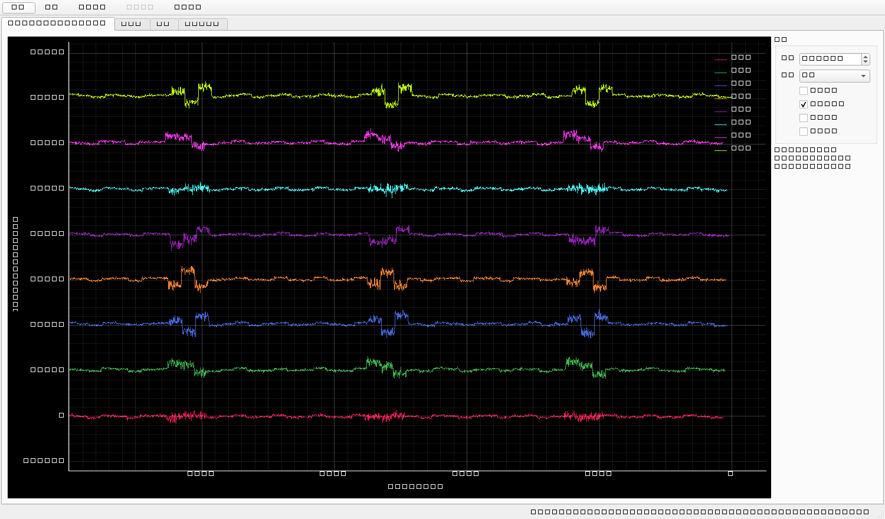
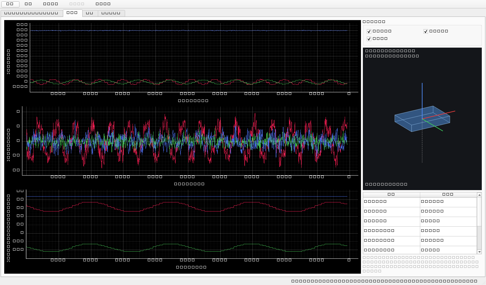
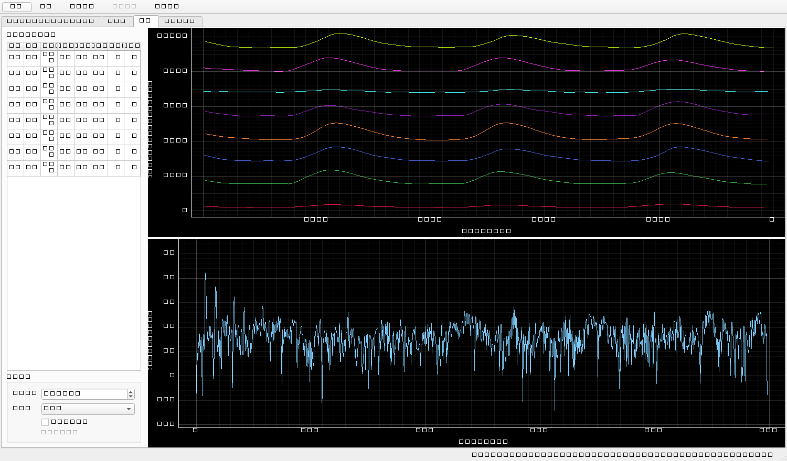
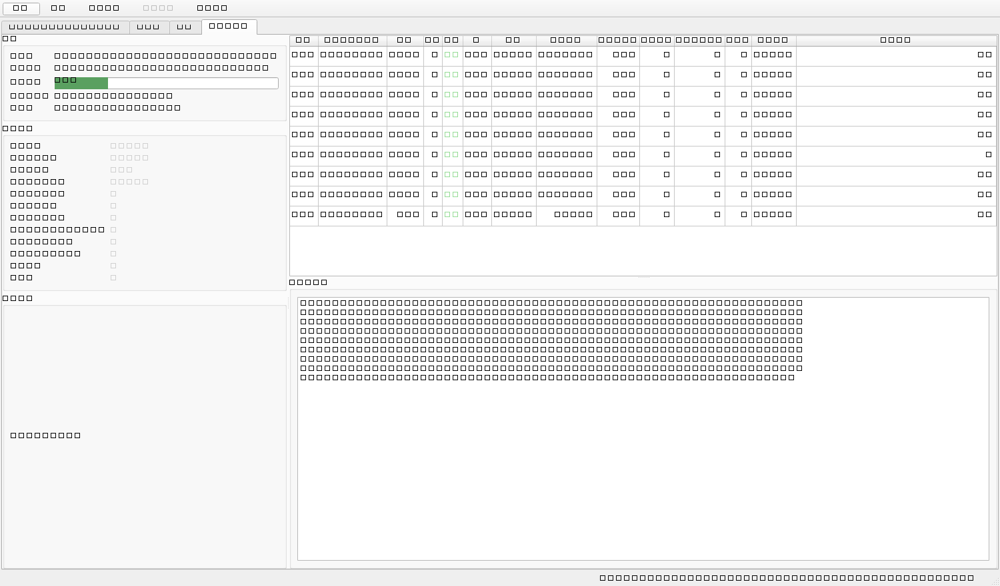

# sEMG-APP-DESKTOP-V1.0

跨平台（Windows / macOS）sEMG + IMU 实时上位机：直接读**蓝牙网关的串口文本输出**，画 8 路 sEMG 与 1 路 IMU 的实时曲线，同时做录制、回放、包络/频谱分析和链路健康判读。

WIFI 网关（`sEMG-WIFI-ESP32-V1.0`）只做 UART↔TCP 透传，所以本工具把 `TCP:3333` 当作同一条字节流的另一种载体，解析逻辑完全共用。

```
sEMG/IMU 节点 ──BLE Notify──> 蓝牙网关(ESP32-S3) ──printf 文本行──┬─> USB 串口(2M/115200) ─> 本工具 SerialSource
                                                                  └─> UART1 115200 ─> WIFI 网关 ─> TCP:3333 ─> 本工具 TcpSource
                                                                                                    本地日志文件 ─> ReplaySource
                                                                                                    内置模拟器    ─> SimulateSource
```

四类来源实现同一个 `DataSource` 接口，回放与硬件采集走**完全相同**的解析与时标路径，因此回放文件看到的曲线和实时看到的曲线可以直接对比。

---

## 1. 快速开始

```powershell
# Windows
powershell -File scripts\run.ps1                      # 默认用内置模拟源起界面
powershell -File scripts\run.ps1 gui --serial COM7    # 接蓝牙网关
powershell -File scripts\run.ps1 selftest             # 无硬件自检整条解析链路
```

```sh
# macOS
./scripts/run.sh                       # 模拟源
./scripts/run.sh gui --serial /dev/cu.usbmodemXXXX
./scripts/run.sh parse records/rec-20261116-0930/raw.log.gz
```

首次运行会自动创建 `.venv` 并装依赖（有 `uv` 就用 `uv`）。手动安装：

```sh
python -m venv .venv && .venv/bin/python -m pip install -e ".[dev]"
```

依赖：PySide6、pyqtgraph、numpy、scipy、pyserial。

---

## 2. 协议对照（已逐行核对网关源码）

网关侧输出在 [`main/app_task_com.c`](../sEMG-GATEWAY-ESP32-V1.0/main/app_task_com.c) 的 `StartComTask()`，用 `printf` 打文本行，**没有长度字段、没有校验**。

| 网关输出 | 本工具解析动作 |
| --- | --- |
| `3/9 semg A4:CF:01 seq=1234 cnt=40 drop=0 101 -98 …` | 一行即一帧，尾部整数按 int16 定点值直接入通道环形缓冲 |
| `9/9 imu 12:34:90 seq=57 cnt=10 drop=1` | 头部行只建立"待收块"上下文，**不产生样本** |
| `0.012 -0.004 0.998 1.200 -0.300 0.000 123 -45 68` | 9 字段数据行，收满 `cnt` 行后一次性成帧（ax ay az 单位 g，gx gy gz 单位 dps，磁力计原始 int16） |
| `I (402) GW: Sensor connected: slot=2 conn=3 type=sEMG mac=AA:BB:CC:A4:CF:01` | 登记设备：完整 MAC、槽位、类型，标记在线 |
| `I (…) GW: Sensor disconnected: slot=2 conn=3` | 标记离线（保留曲线与统计，便于回看掉线前波形） |
| `W (…) GW: print queue overflow(total)=17` | 计入链路告警，面板"判读提示"里点名 |
| `ping_rtt conn=3 us=45120` | 记录往返时延 |

解析器要处理的三个坑，都已做成用例（`tests/test_protocol.py`）：

1. **IMU 是多行结构**：数据行本身不带设备标识，只能靠"头部行 + 计数"配对。网关在 `avail_samples < cnt` 时会少打几行，所以任何新的头部行都会先截断上一块并计数 `imu_block_truncated`，绝不死等。
2. **一行可能被拆到两次 read 之间**：解析器按字节缓冲到 `\n` 才处理，逐字节喂进去也能还原完整帧。
3. **状态行来自别的任务**：`printf` 与 `ESP_LOG` 共用 stdout，日志行可能夹在 IMU 数据行中间。非 9 字段的行不会清掉待收块，只算未识别行。

同时会剥掉 ANSI 颜色序列和 `I (tick) TAG: ` 前缀（`CONFIG_BOOTLOADER_LOG_COLORS` 虽关，但应用侧 esp_log 仍可能带色）。

**没有校验怎么发现错？** 协议给不了 CRC，本工具用三个可检测信号代替，全部计入面板：字段数与 `cnt` 的一致性、数值是否落在 int16 / 物理量程（加速度 ±50 g、角速度 ±4000 dps）、行长度是否超过网关 `FRAME_LINE_MAX=1024`。字节丢失造成的"看着合法但内容错"的行无法在此层面发现，这是文本协议的固有上限。

---

## 3. 时标重建（协议里没有时间戳）

帧内样本的间隔用 `seq` 反推，而不是到达时刻：

```
device_time += Δseq × period          # period 由到达间隔中位数自估，不写死 2 kHz
host_time   = offset + device_time + i × period / n
```

- `period` 自估：所以节点侧 `CONFIG_FREERTOS_HZ` 是 1000（500 Hz）还是 100（50 Hz）都不用先验知道，面板显示的"实测速率"就是估出来的结果，可以直接用来验证固件到底跑在多少。
- `offset` 用只追赶正误差的小增益 PLL：传输只会让到达变晚，变早意味着在读文件（链路不可能比发送端快），此时**不回拉**，否则整段数据会被挤到一起。
- `Δseq > 1` 在时间轴上留下等长缺口，掉样看得见，不会被插值抹平。
- `seq` 按 uint16 回绕解算；`Δseq > max_gap(256)` 视为节点重启，重锚而不是补 5 s 空洞。

通道身份用 **MAC 后 3 字节**而不是槽位号：槽位是连接顺序的产物，重连就会变，MAC 不会。映射写入 `config/default.json` 的 `channel_map`，多次会话之间 CH1…CH8 的位置保持稳定。

---

## 4. 带宽预算：为什么 WIFI 透传这条路撑不住

文本协议的下限很高。按网关格式估算单帧字节数：

| 流 | 单帧 | 帧率 | 字节速率 |
| --- | --- | --- | --- |
| 1 路 sEMG（40 样本） | ≈ 46 B 头 + 40×5.5 B ≈ 266 B | 50 帧/s | ≈ 13.3 KB/s |
| 8 路 sEMG | | | ≈ 106 KB/s |
| 1 路 IMU（10 组×9 字段） | ≈ 46 B + 10×55 B ≈ 596 B | 50 帧/s | ≈ 30 KB/s |
| **合计 8+1** | | | **≈ 136 KB/s** |

对照三条物理链路：

| 载体 | 容量 | 结论 |
| --- | --- | --- |
| ESP32-S3 原生 USB（USB-Serial/JTAG 从控制台） | USB 块传输，与 UART 波特率无关 | 唯一能跑满 8+1 的路径 |
| UART0 @ 2 000 000 | ≈ 200 KB/s | 勉强够，占用约 68%，网关打印任务仍会偶发 `print queue overflow` |
| UART0 / WIFI 网关 UART1 @ 115 200 | ≈ 11.5 KB/s | 差 12 倍，只能保住不到 1 路，必然大量丢样 |

> ⚠️ 实测配置不一致：网关 `README.md` 与 `sdkconfig.defaults` 写 2 M，但**当前入库的 `sdkconfig` 是 `CONFIG_ESP_CONSOLE_UART_BAUDRATE=115200`**。接 UART 前先用 `idf.py menuconfig` 确认，或直接用 S3 的原生 USB 口。

界面因此把链路速率做成一等公民：状态页显示实测 B/s、容量占用条（>85% 变红）、以及网关自己报的 `overflow` 次数，"是不是链路不够"一眼能判断，不用猜。

---

## 5. 界面

四个页签，数据只有一份，切页不重新采集。

- **实时曲线**：8 通道堆叠 / 叠加 / 2×4 网格三种排布，峰值降采样 + 视口裁剪；可选叠加 4 Hz 包络；拖选区可直接喂给分析页；支持冻结画面读数。
- **IMU**：加速度(g)/角速度(dps)/磁力计(原始) 三张子图 + 姿态方块（roll/pitch 由重力向量求，磁力计未标定所以不给航向）+ 9 分量当前值表。
- **分析**：每通道样本数、实测速率、峰峰值、RMS、MAV、iEMG、int16 削顶计数；8 通道包络分层图；选中通道的 Welch 功率谱（对账 50 Hz 陷波是否生效很直接）。
- **状态与链路**：设备表（在线、槽位、MAC、帧数、样本数、实测速率、最后 seq、drop、seq 缺口帧、重同步、缓冲、距今 ms）、链路速率与容量占用、12 项解析计数、判读提示、网关状态行原文。

截图（`scripts/ui_preview.py` 离屏渲染，无显示器也能出图）：

| | |
| --- | --- |
|  |  |
|  |  |

---

## 6. 命令行

```
semg-desktop gui [--serial COM7 | --tcp 192.168.4.1:3333 | --replay f.log.gz | --simulate]
semg-desktop selftest [--duration 3]     # 模拟源灌整条链路并自检，返回码可用于 CI
semg-desktop parse <raw日志>              # 离线体检：每设备帧数/样本/速率/缺口 + 解析异常计数
semg-desktop export <会话目录>            # npz -> 长表 CSV
semg-desktop ports                        # 列串口
```

`parse` 是给固件调试用的：先原样存下串口文本，再用它判断"到底是链路断了、还是 `cnt` 没到齐、还是字节丢了"。

---

## 7. 录制与数据格式

一次录制是一个会话目录：

```
records/rec-YYYYmmdd-HHMMSS/
├── raw.log.gz        # 原始字节 tee（gzip-1），回放与复现的唯一真源
├── manifest.json     # 起始 UTC、数据源描述、通道映射、字节/样本数、配置快照
└── parsed/
    ├── data.npz      # 每设备 t（相对会话秒）+ semg@MAC / ax_g@IMU…mz_raw@MAC
    └── data_long.csv # export 生成：t_seconds, device_mac_suffix, signal, value
```

热路径只做"字节 tee + 数组追加"两件事，CSV 格式化留给离线 `export`，避免每秒上万次字符串拼接挤占采集线程。

---

## 8. 配置

`config/default.json`，关键项：

| 键 | 默认 | 说明 |
| --- | --- | --- |
| `buffer_seconds` | 60 | 每通道环形缓冲时长 |
| `display_span_seconds` | 2.0 | 默认窗口 |
| `protocol.frame_period_seconds` | 0.02 | 名义帧周期（自估的初值与合法带宽基准） |
| `protocol.pll_gain` / `resync_threshold_seconds` | 0.02 / 0.30 | 时标 PLL |
| `semg.channel_count` | 8 | 接进更多设备会自动往后排，不丢数据 |
| `analytics.envelope_cutoff_hz` | 4.0 | 包络低通 |
| `link.serial_capacity_bytes_per_second` | 200000 | 容量占用条分母（2 Mbaud） |
| `link.tcp_capacity_bytes_per_second` | 11520 | WIFI 网关 UART1 上限 |
| `channel_map` | `{}` | 断开时自动写回 |

---

## 9. 测试与验证

```sh
.venv/bin/python -m pytest -q          # 69 个用例
.venv/bin/python -m semg_desktop selftest
```

覆盖：协议行级/字节级解析与失步恢复、ANSI/日志前缀、IMU 多行配对与截断、seq 回绕与缺口、PLL 抗抖动、全速灌文件不压缩时标、环形缓冲回绕、包络/RMS/iEMG/PSD 数值正确性、录制→回放→再解析的字节级闭环、TCP 源对真实 socket 的流式接收、四个视图的离屏渲染冒烟。

---

## 10. 已知限制

- **文本协议无校验**：字节丢失可能产生"合法但错误"的样本，只能靠统计量发现，不能纠正。要根治得在网关侧加长度+CRC 或改二进制输出（网关 README 也把这条列为后续方向）。
- **协议无时间戳**：时标是重建的，跨通道对齐误差量级等于一次 read 的攒包时间（约几毫秒到几十毫秒），做通道间相位分析时要把这点考虑进去。
- **WIFI 透传只适合看趋势**：115200 的硬上限在那儿，除非网关降打印密度或改二进制。
- **无断线自动重连**：源报错就停并显示原因，需要手动重连，避免长时间录制里悄悄丢数据。
- **磁力计不给航向**：JY931 原始 int16 未做硬磁/软磁标定，算出来的 heading 不可信，宁可不显示。
- **sEMG 纵轴是 ADC 定点值**：节点侧上报的是滤波后截断到 int16 的定点数，固件没给电压换算关系，所以不做 mV 标定；削顶样本数会单独计数提示前端饱和。
