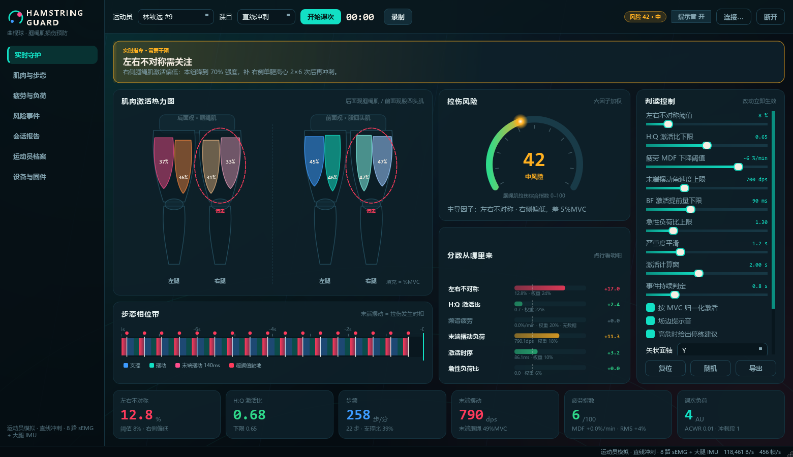
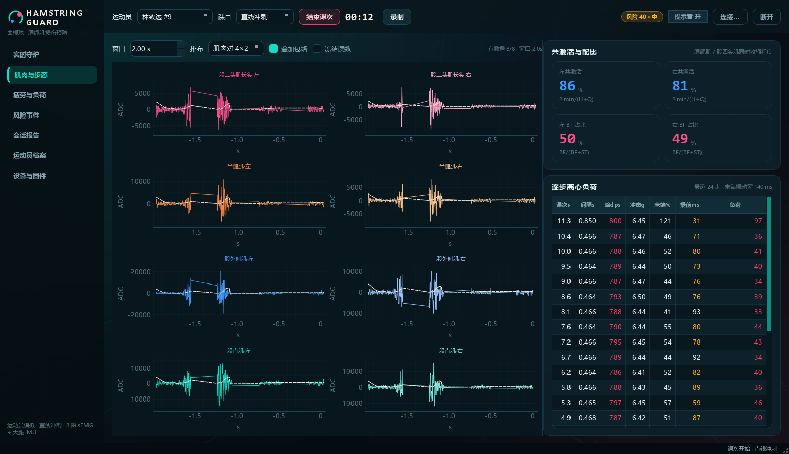
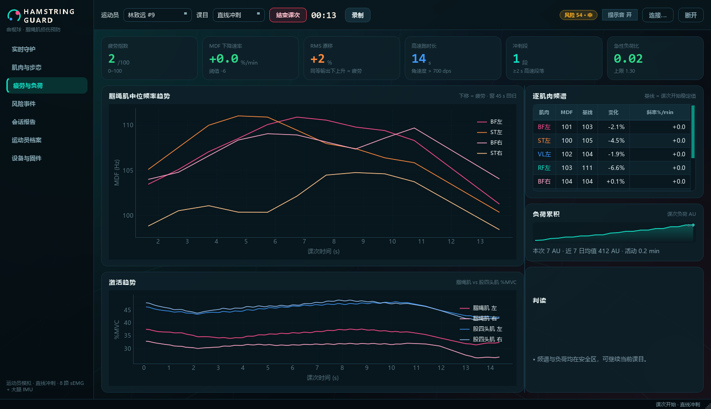
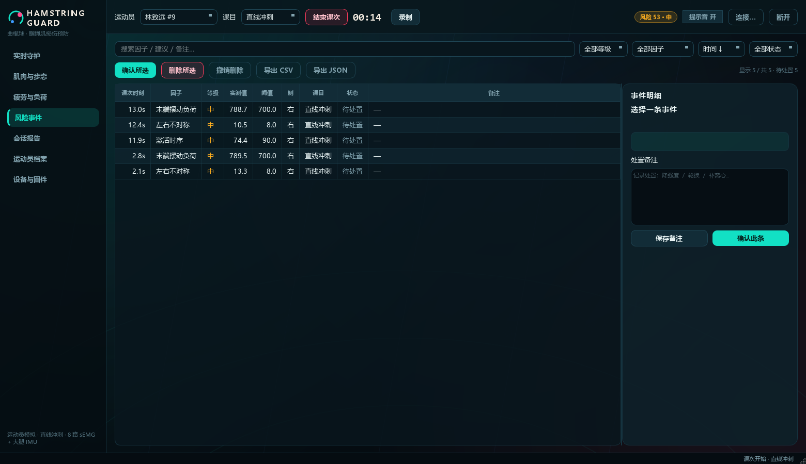
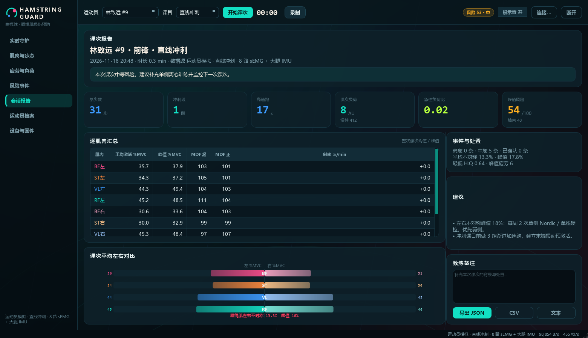
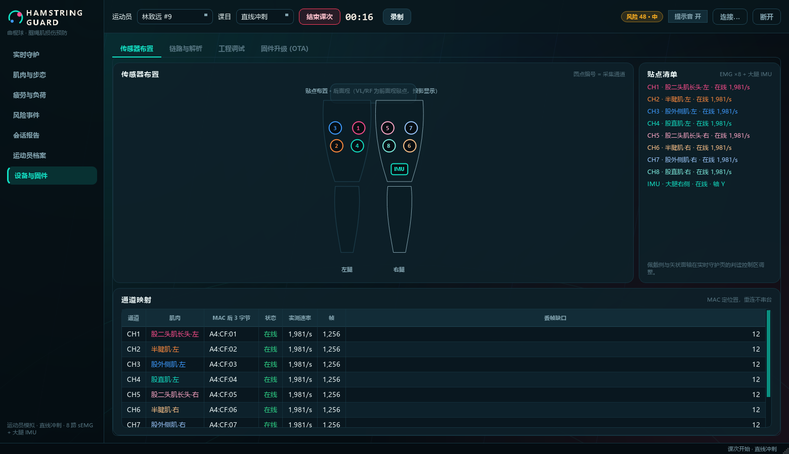

# sEMG-APP-DESKTOP-V1.0 · HAMSTRING GUARD

面向**曲棍球运动员腘绳肌损伤预防**的可穿戴多模态监测与实时反馈上位机（Windows / macOS）。
底层读**蓝牙网关的串口文本输出**（8 路 sEMG + 1 路大腿 IMU），上层把信号翻译成运动医学量：
肌肉激活 %MVC、H:Q 激活比、左右不对称、共激活、频谱疲劳（MDF 下移）、步态末端摆动离心负荷、
激活时序与急性负荷比，合成一个**可解释的 0–100 拉伤风险指数**，并在场边给出实时干预指令。

WIFI 网关（`sEMG-WIFI-ESP32-V1.0`）只做 UART↔TCP 透传，所以本工具把 `TCP:3333` 当作同一条字节流的另一种载体，解析逻辑完全共用。

```
sEMG/IMU 节点 ──BLE Notify──> 蓝牙网关(ESP32-S3) ──printf 文本行──┬─> USB 串口(2M) ─> 本工具 SerialSource
                                                                  └─> UART1 115200 ─> WIFI 网关 ─> TCP:3333 ─> 本工具 TcpSource
                                                                                                    本地日志文件 ─> ReplaySource
                                                                                                    内置模拟器    ─> SimulateSource
```

四类来源实现同一个 `DataSource` 接口，回放与硬件采集走**完全相同**的解析与时标路径，因此回放文件看到的曲线和实时看到的曲线可以直接对比。

---

## 1. 快速开始

```powershell
# Windows
powershell -File scripts\run.ps1                      # 默认用运动员步态锁定模拟起界面
powershell -File scripts\run.ps1 gui --serial COM7    # 接蓝牙网关
powershell -File scripts\run.ps1 selftest             # 无硬件自检整条解析链路
```

```sh
# macOS
./scripts/run.sh                       # 模拟源
./scripts/run.sh gui --serial /dev/cu.usbmodemXXXX
./scripts/run.sh parse records/rec-20261116-0930/raw.log.gz
```

首次运行会自动创建 `.venv` 并装依赖（有 `uv` 就用 `uv`）。手动安装：

```sh
python -m venv .venv && .venv/bin/python -m pip install -e ".[dev]"
```

依赖：PySide6、pyqtgraph、numpy、scipy、pyserial、bleak（只做固件升级页用，缺它界面照样起，OTA 页会提示装）。

打包 Windows 免安装 exe（onedir：exe + `_internal` 文件夹，整体拷贝即可分发）：

```powershell
uv pip install --python .venv\Scripts\python.exe pyinstaller
.venv\Scripts\python.exe -m PyInstaller semg_desktop.spec --noconfirm
# 产物：dist\semg-desktop\semg-desktop.exe
```

录制与通道映射写在 exe 旁的 `records/` 与 `_internal/config/`；运动员档案（含 MVC 基线）首跑自动
seeding 到 `_internal/config/athletes.json`。构建前先关掉正在运行的
semg-desktop.exe，否则 COLLECT 清理 dist 时会因 DLL 被占用而报 PermissionError；
不想关运行中的实例时用 `--distpath dist-new --workpath build-new` 旁路打包再替换。

---

## 2. 协议对照（已逐行核对网关源码）

网关侧输出在 [`main/app_task_com.c`](../sEMG-GATEWAY-ESP32-V1.0/main/app_task_com.c) 的 `StartComTask()`，用 `printf` 打文本行，**没有长度字段、没有校验**。

| 网关输出 | 本工具解析动作 |
| --- | --- |
| `3/9 semg A4:CF:01 seq=1234 cnt=40 drop=0 101 -98 …` | 一行即一帧，尾部整数按 int16 定点值直接入通道环形缓冲 |
| `9/9 imu 12:34:90 seq=57 cnt=10 drop=1` | 头部行只建立"待收块"上下文，**不产生样本** |
| `0.012 -0.004 0.998 1.200 -0.300 0.000 123 -45 68` | 9 字段数据行，收满 `cnt` 行后一次性成帧（ax ay az 单位 g，gx gy gz 单位 dps，磁力计原始 int16） |
| `I (402) GW: Sensor connected: slot=2 conn=3 type=sEMG mac=AA:BB:CC:A4:CF:01` | 登记设备：完整 MAC、槽位、类型，标记在线 |
| `I (…) GW: Sensor disconnected: slot=2 conn=3` | 标记离线（保留曲线与统计，便于回看掉线前波形） |
| `W (…) GW: print queue overflow(total)=17` | 计入链路告警，面板"判读提示"里点名 |
| `ping_rtt conn=3 us=45120` | 记录往返时延 |

解析器要处理的三个坑，都已做成用例（`tests/test_protocol.py`）：

1. **IMU 是多行结构**：数据行本身不带设备标识，只能靠"头部行 + 计数"配对。网关在 `avail_samples < cnt` 时会少打几行，所以任何新的头部行都会先截断上一块并计数 `imu_block_truncated`，绝不死等。
2. **一行可能被拆到两次 read 之间**：解析器按字节缓冲到 `\n` 才处理，逐字节喂进去也能还原完整帧。
3. **状态行来自别的任务**：`printf` 与 `ESP_LOG` 共用 stdout，日志行可能夹在 IMU 数据行中间。非 9 字段的行不会清掉待收块，只算未识别行。

同时会剥掉 ANSI 颜色序列和 `I (tick) TAG: ` 前缀（`CONFIG_BOOTLOADER_LOG_COLORS` 虽关，但应用侧 esp_log 仍可能带色）。

**没有校验怎么发现错？** 协议给不了 CRC，本工具用三个可检测信号代替，全部计入面板：字段数与 `cnt` 的一致性、数值是否落在 int16 / 物理量程（加速度 ±50 g、角速度 ±4000 dps）、行长度是否超过网关 `FRAME_LINE_MAX=1024`。字节丢失造成的"看着合法但内容错"的行无法在此层面发现，这是文本协议的固有上限。

---

## 3. 时标重建（协议里没有时间戳）

帧内样本的间隔用 `seq` 反推，而不是到达时刻：

```
device_time += Δseq × period          # period 由到达间隔中位数自估，不写死 2 kHz
host_time   = offset + device_time + i × period / n
```

- `period` 自估：所以节点侧 `CONFIG_FREERTOS_HZ` 是 1000（500 Hz）还是 100（50 Hz）都不用先验知道，面板显示的"实测速率"就是估出来的结果，可以直接用来验证固件到底跑在多少。
- `offset` 用只追赶正误差的小增益 PLL：传输只会让到达变晚，变早意味着在读文件（链路不可能比发送端快），此时**不回拉**，否则整段数据会被挤到一起。
- `Δseq > 1` 在时间轴上留下等长缺口，掉样看得见，不会被插值抹平。
- `seq` 按 uint16 回绕解算；`Δseq > max_gap(256)` 视为节点重启，重锚而不是补 5 s 空洞。

通道身份用 **MAC 后 3 字节**而不是槽位号：槽位是连接顺序的产物，重连就会变，MAC 不会。映射写入 `config/default.json` 的 `channel_map`，多次会话之间 CH1…CH8 的位置保持稳定。

---

## 4. 带宽预算：为什么 WIFI 透传这条路撑不住

文本协议的下限很高。按网关格式估算单帧字节数：

| 流 | 单帧 | 帧率 | 字节速率 |
| --- | --- | --- | --- |
| 1 路 sEMG（40 样本） | ≈ 46 B 头 + 40×5.5 B ≈ 266 B | 50 帧/s | ≈ 13.3 KB/s |
| 8 路 sEMG | | | ≈ 106 KB/s |
| 1 路 IMU（10 组×9 字段） | ≈ 46 B + 10×55 B ≈ 596 B | 50 帧/s | ≈ 30 KB/s |
| **合计 8+1** | | | **≈ 136 KB/s** |

对照两条物理链路：

| 载体 | 容量 | 结论 |
| --- | --- | --- |
| UART0 @ 2 000 000 | ≈ 200 KB/s | 勉强够，占用约 68%，网关打印任务仍会偶发 `print queue overflow` |
| UART0 / WIFI 网关 UART1 @ 115 200 | ≈ 11.5 KB/s | 差 12 倍，只能保住不到 1 路，必然大量丢样 |

界面因此把链路速率做成一等公民：状态页显示实测 B/s、容量占用条（>85% 变红）、以及网关自己报的 `overflow` 次数，"是不是链路不够"一眼能判断，不用猜。

---

## 5. 判读口径（领域层 `semg_desktop/guard/`）

8 路 sEMG 不是 CH1..CH8，而是双侧四块肌肉：**BF 股二头肌长头 / ST 半腱肌**（腘绳肌，暖色）与
**VL 股外侧肌 / RF 股直肌**（股四头肌，冷色），左右靠明度成对。IMU 贴大腿，矢状面轴与佩戴侧可在界面改。

| 量 | 算法 | 为什么与拉伤相关 |
| --- | --- | --- |
| 激活 %MVC | 包络均值 / 该肌肉 MVC 基线 | 募集不足或代偿一目了然 |
| 左右不对称 | \|L−R\| / max(L,R) | 伤后侧募集下降是最强的再伤预测因子之一 |
| H:Q 激活比 | 腘绳肌 / 股四头肌 | 比值低 = 离心保护相对不足 |
| 共激活 CCI | 2·min(H,Q)/(H+Q) | 关节稳定策略 |
| 频谱疲劳 | Welch MDF（20–450 Hz）45 s 窗回归 %/min，伴 RMS 漂移 | MDF 下移 + RMS 上升 = 外周疲劳 |
| 末端摆动负荷 | 触地前 140 ms 窗内腘绳肌激活 × 摆动峰角速度 | 拉伤几乎都发生在末端摆动离心期 |
| 激活时序 | BF 包络 onset 相对触地的提前量 ms | 预激活越晚，离心保护越差 |
| 急性负荷比 | 本次课次负荷 AU / 近 7 日慢性均值 | 负荷突增是再伤诱因 |

风险指数 = 六因子严重度加权和（权重公开显示在"分数从哪里来"），严重度经 EMA 平滑、越限需持续
`sustain_seconds` 才记事件、每因子有冷却，避免抖动刷屏。**步态级时序用 20 Hz 零相位快包络 + 绝对时标窗**：
显示用的 4 Hz 包络群延迟约 80 ms，直接拿它做末端摆动窗会把离心峰整段错到触地之后。

MDF 估计有三道防假阳性闸门：窗必须装满（≥3.8 s）、前 3 个读数取中位数做 EMA 初值（暖机）、
回归跨度 ≥15 s 且设 1%/min 死区。短窗 Welch 抖动可达 ±10 Hz，不设闸会读出 ±20%/min 的假疲劳。

## 6. 界面

左侧固定导航 + 顶栏（运动员 / 课目 / 课次计时 / 录制 / 风险 / 静音 / 连接），数据只有一份，切页不重新采集。

- **实时守护**：肌肉激活热力图（后面观腘绳肌 / 前面观股四头肌，填充度 = %MVC，伤史侧虚线环）、
  步态相位带（支撑 / 摆动 / 末端摆动，超阈值触地标红）、风险仪表 + 因子贡献分解、实时指令横幅；
  右侧**常驻判读控制区** 14 个实时控件（不对称 / H:Q / 疲劳 / 摆动 / 时序 / 负荷阈值、平滑、计算窗、
  MVC 归一化、提示音、停练建议、矢状面轴、佩戴侧、疲劳推演倍率）+ 复位 / 随机 / 导出，动一下立刻生效。
- **肌肉与步态**：8 路波形按"肌肉对 × 左右"排布 + 包络叠加 + 冻结读数；共激活 / BF 占比；逐步离心负荷表。
- **疲劳与负荷**：腘绳肌 MDF 趋势、激活趋势、逐肌肉频谱表、负荷累积 sparkline、判读文字。
- **风险事件**：筛选 / 搜索 / 排序、批量确认、删除带撤销、处置备注、明细抽屉、导出 CSV/JSON。
- **会话报告**：结束课次自动生成结论 + 逐肌肉汇总 + 平均左右对比 + 建议，导出 JSON/CSV/文本，落盘 `session_summary.json`。
- **运动员档案**：名单 CRUD + 搜索/过滤/排序 + 撤销删除、MVC 基线编辑与**实时标定**、伤史与复出周、慢性负荷。
- **设备与固件**：传感器布置图 + 贴点清单 + 通道映射；链路与解析（原状态页）；工程调试（原始 sEMG/IMU/频谱）；OTA。

提示音默认开、顶栏一键静音：watch 单声 / warn 双声 / stop 三声，每个音对应一个看得见的界面事件。
无硬件时默认接**运动员模拟源**（`AthleteSimSource`）：EMG 爆发与步态相位锁定、带通上截止随疲劳下移、
左右不对称按档案推演，输出仍是网关文本协议，因此解析/时标/录制与真实硬件走同一条路。

截图（`scripts/ui_preview.py` 离屏渲染并驱动完整课次闭环，无显示器也能出图）：

| | |
| --- | --- |
|  |  |
|  |  |
|  |  |

---

## 7. 命令行

```
semg-desktop gui [--serial COM7 | --tcp 192.168.4.1:3333 | --replay f.log.gz | --simulate | --athlete]
                                         # 不给源时默认运动员步态锁定模拟
semg-desktop selftest [--duration 3]     # 模拟源灌整条链路并自检，返回码可用于 CI
semg-desktop parse <raw日志>              # 离线体检：每设备帧数/样本/速率/缺口 + 解析异常计数
semg-desktop export <会话目录>            # npz -> 长表 CSV
semg-desktop ports                        # 列串口
python scripts/guard_probe.py --seconds 20 --rate 6 --athlete ath-lin   # 无硬件核对领域量
```

`parse` 是给固件调试用的：先原样存下串口文本，再用它判断"到底是链路断了、还是 `cnt` 没到齐、还是字节丢了"。

---

## 8. 录制与数据格式

一次录制是一个会话目录：

```
records/rec-YYYYmmdd-HHMMSS/
├── raw.log.gz        # 原始字节 tee（gzip-1），回放与复现的唯一真源
├── manifest.json     # 起始 UTC、数据源描述、通道映射、字节/样本数、配置快照
└── parsed/
    ├── data.npz      # 每设备 t（相对会话秒）+ semg@MAC / ax_g@IMU…mz_raw@MAC
    └── data_long.csv # export 生成：t_seconds, device_mac_suffix, signal, value
```

热路径只做"字节 tee + 数组追加"两件事，CSV 格式化留给离线 `export`，避免每秒上万次字符串拼接挤占采集线程。

---

## 9. 配置

`config/default.json`，关键项：

| 键 | 默认 | 说明 |
| --- | --- | --- |
| `buffer_seconds` | 60 | 每通道环形缓冲时长 |
| `display_span_seconds` | 2.0 | 默认窗口 |
| `protocol.frame_period_seconds` | 0.02 | 名义帧周期（自估的初值与合法带宽基准） |
| `protocol.pll_gain` / `resync_threshold_seconds` | 0.02 / 0.30 | 时标 PLL |
| `semg.channel_count` | 8 | 接进更多设备会自动往后排，不丢数据 |
| `analytics.envelope_cutoff_hz` | 4.0 | 包络低通 |
| `link.serial_capacity_bytes_per_second` | 200000 | 容量占用条分母（2 Mbaud） |
| `link.tcp_capacity_bytes_per_second` | 11520 | WIFI 网关 UART1 上限 |
| `ota.receiver_name_prefix` | `nimble-ble-ota` | 接收固件广播名前缀（与 `sEMG-OTA` 工程一致就别动） |
| `ota.scan_timeout_seconds` / `reboot_wait_seconds` / `ack_timeout_seconds` | 8 / 1.5 / 15 | 单轮扫描**上限**（扫到目标会提前收工）、触发后的固定等待、单扇区 ACK 等待 |
| `ota.settle_seconds` | 1.5 | 连上接收固件后的静置：接收固件是"先开始广播、后注册数据回调和 ota_task"，抢连太快会写进没人收 |
| `ota.trigger_wait_seconds` | 60 | 阶段 1 等节点空闲广播的上限：网关不断电时靠这段时间把网关搬走 |
| `ota.firmware_dir` / `default_bins` | `""` | 固件对话框起始目录与 EMG/IMU 默认 bin 路径 |
| `channel_map` | `{}` | 断开时自动写回 |

---

## 10. 固件升级（EMG / IMU OTA）

四块板共用一套双固件设计（见 [`sEMG-OTA-ESP32-V1.0`](../sEMG-OTA-ESP32-V1.0/README.md)）：`factory` 常驻一个与业务无关的 BLE 接收固件，`ota_0`/`ota_1` 放业务固件，A/B 交替写、旧槽留给 bootloader 回滚。本工具负责把新的应用固件灌进去，与工厂脚本 `tools/ble_ota_send.py` 同协议，只是带进度、可取消、能把 8 路 EMG 排着队一起升。

两阶段：

1. **触发**：连上节点的 GATT 特征 `0xFFF1` 写 4 字节 `"OTA!"`。节点把当前槽记进 NVS，切启动分区到 `factory` 后重启。
2. **传输**：连上接收固件（广播名 `nimble-ble-ota`），命令特征 `0x8022` 发 `01 00 <固件长度:u32le>`，固件按 4096 字节一扇区、每包 `<扇区:u16le><包号:u8> + 净载` 写 `0x8020`；只有扇区末包回 20 字节 ACK（`[2]`=状态，`[18:20]`=CRC16-CCITT），状态 `02` 就整扇区重传。写完发 `02 00`，节点重启进新槽。

包号只有 1 字节、`0xFF` 又被末包占用，所以每扇区最多 255 包，净载下限 17 字节（MTU ≥ 25）。接收固件按 517 配置；万一 MTU 没谈下来，本工具会直接报"每扇区会超过 255 包"而不会把包号写溢出——这条上限在工厂脚本 `ble_ota_send.py` 里是没设防的。

**耗时花在哪（实测）**：561 KB 的 IMU 固件 = 1234 包（净载 509 B）+ 138 次扇区 ACK。`0x8020` 只开了 `BLE_GATT_CHR_F_WRITE`（没有 `WRITE_NO_RSP`），每包都要吃一次 ATT 应答往返。分段计时显示 **138 次扇区 ACK 合计 0.0 s，时间全在带应答写上**——所以瓶颈是连接间隔，不是闪存。Windows 默认给这条 GATT 连接 60 ms 间隔（实测 158 ms/包，3 KB/s，195 s）；接收固件现在会在连接建立后主动请求 7.5–15 ms，Windows 接受到 15 ms（实测 40 ms/包，**11 KB/s，49 s**，约 4 倍）。上位机侧另外砍了固定开销：扫描"扫到就走"、触发后固定等待 6s→1.5s、结束命令 ACK 3s→0.5s。日志里每台都打"传完 X B 用时 Y s（Z KB/s）"、"均 N ms/包"和"整机 N s"，慢在哪一段一眼可见。

再快只剩一刀：给接收固件 `0x8020` 的 flags 加 `BLE_GATT_CHR_F_WRITE_NO_RSP`，扇区内多包流水、只在末包等 ACK。组件没有这个配置项且 `managed_components` 未入库，要做得先把组件 vendored 进工程，所以暂未动。

**升级后校验版本**：设备收满字节就自行重启，"校验失败回退"和"正常完成"在 PC 侧看到的断链一模一样，光看传输会把拒收报成成功（坏镜像实机测试暴露过）。所以应用固件在 `0xFFF0` 服务里加了只读特征 **`0xFFF2`**（`version[32] + app_elf_sha256[32]`），本工具传完后重连应用读回，与 `.bin` 偏移 `0x20` 处 `esp_app_desc_t` 里的指纹比对：不一致判"设备拒收或回滚了"。比 sha 而不是比版本号——实测同一版本号重新构建后 sha 会变，比版本号会漏判。旧应用固件没有 `0xFFF2` 时降级为"校验跳过"，不误判失败。

> 残留局限：描述符里的 sha 标识的是**构建**而非收到的字节。若灌的是同一构建的坏副本、设备拒收后回退到同一构建，sha 仍会匹配，检不出来。要彻底闭环得让接收固件在 `esp_ota_end` 失败时先回一条结果指示再重启（或上报它实际算出的镜像哈希）。

三个容易踩的坑，日志里都会明确区分：

* **结束命令必然断链**。接收固件的 `ota_task` 一收满 `fw_len` 字节就 `esp_restart()`，不等 `02 00`，所以那条写会抛 `BleakError: disconnected`。完成与否的判据是"所有扇区都被 ACK 过"，这一步的异常按完成处理，不报失败。
* **同一个地址两套 GATT 表，Windows 会喂你旧的**。双固件沿用同一个 BLE 地址，而 WinRT 的 GATT 缓存按地址存：连上接收固件却拿到应用固件那张服务表，`0x8020` 就"不存在"（`BleakCharacteristicNotFoundError`）。所以连上后先验服务表（`has_ota_profile`），不对就用 `BluetoothCacheMode.UNCACHED` 强刷一次再断开重连；刷不动才报错，并提示停用/启用适配器。同理，广播名优先取广播帧里的 `local_name` 而不是可能被缓存的 `dev.name`。
* **连上太快会写进没人收的窗口**。`app_main` 里 `esp_ble_ota_host_init()` 一开始广播，数据回调和 `ota_task` 还在后面两行 —— 扫描改成"扫到就连"之后正好可能撞上，表现为开始命令等不到 ACK。所以连上后静置 `settle_seconds` 再动 GATT。

操作顺序：

1. 在 EMG / IMU 工程里 `idf.py build`，产物 `build/bleprph.bin`（必须 ≤ 2 MB，超了直接挡住）。
2. **让目标节点空闲广播** —— 最容易踩的一条：应用固件被网关连上后就停止广播了（bleprph 只在断开后重新 advertise），上位机既搜不到它、也写不进触发字。三种办法任选：
   - 网关断电，或让节点单独上电（最干净）；
   - **不给网关断电**：先点开始升级，再把网关搬远/关进金属柜 —— 网关侧监督超时是 4 s（`main.c` 里 `supervision_timeout = 400`），断开后节点立刻恢复广播，阶段 1 会在 `trigger_wait_seconds`（默认 60 s）内持续扫描并自动抢下这次连接；进阶段 2 后把网关搬回来也不影响，网关不认 `nimble-ble-ota`；
   - 节点本来就卡在接收固件模式（上次升级中断）：阶段 1 会识别出来并跳过触发直接续传。
3. 打开"固件升级 (OTA)"页 → 选 EMG / IMU 固件 → **扫描 BLE 节点** → 勾选 → 开始升级。
4. 阶段 2 不用管网关：网关只连 `EMG-*` / `IMU-*`（兼容旧 `sEMG-*`），不会去抢 `nimble-ble-ota`。

设备行按 MAC 后 3 字节归并，两个来源合成一张表：

| 来源 | 提供什么 |
| --- | --- |
| 网关文本流（connected 行） | 通道号、类型、**完整 BLE 地址**（`mac=` 就是节点地址本身） |
| BLE 扫描 | 此刻真正能连上的节点、是否已处于接收固件模式 |

有完整地址就按地址锁定，8 路同型号 EMG 不会串台；地址未知的行只能用"为选中行单独指定固件"，而且当场内还有第二台接收固件时直接拒绝开始 —— 宁可不灌，也不把 A 板的固件写进 B 板。

失败与中断的兜底：新槽写完才切启动分区，切换时把旧槽一起登记，所以传一半断电、按取消、新固件自检不过，都会回到旧固件。节点卡在接收固件模式时，重新扫描会出现"接收中"标记，此时跳过触发直接续传。接收固件本身也带**滑动空闲超时**（`CONFIG_SEMG_OTA_IDLE_TIMEOUT_S`，默认 90 s）和错误回退：没人来灌固件或传输出错时，它自己回到上次正常的槽，不再需要拿 UART 去救（详见 `sEMG-OTA-ESP32-V1.0` 的 README）。

> 网关自身与 WIFI 板的触发方式不同（UART 控制台 `ota` / TCP 收 `"OTA!"`），本页只管 EMG 与 IMU 这两类 BLE 外围。

---

## 11. 测试与验证

```sh
.venv/bin/python -m pytest -q          # 165 个用例
.venv/bin/python -m semg_desktop selftest
python scripts/ui_preview.py           # 离屏驱动完整课次闭环并逐页出图
```

覆盖：协议行级/字节级解析与失步恢复、ANSI/日志前缀、IMU 多行配对与截断、seq 回绕与缺口、PLL 抗抖动、全速灌文件不压缩时标、环形缓冲回绕、包络/RMS/iEMG/PSD 数值正确性、录制→回放→再解析的字节级闭环、TCP 源对真实 socket 的流式接收、OTA 分包与 ACK/CRC 与地址匹配与编排（不碰蓝牙硬件）；
领域层：解剖映射、MDF 随带通下移、步态峰/冲击检测与间隔、小批量 IMU 不崩、激活/不对称/末端摆动/时序数值合理性、疲劳随课次升级风险、MDF 暖机不造假斜率、MVC 标定、课次汇总、档案 CRUD/搜索/排序/撤销、事件确认/备注/删除/撤销；
界面：七页离屏渲染、课次闭环生成报告、阈值滑杆实时生效、切运动员重建模拟生理、缩放与重复课次/切换的线程与状态稳定性、事件批量处置与批量撤销。

---

## 12. 已知限制

- **文本协议无校验**：字节丢失可能产生"合法但错误"的样本，只能靠统计量发现，不能纠正。要根治得在网关侧加长度+CRC 或改二进制输出（网关 README 也把这条列为后续方向）。
- **协议无时间戳**：时标是重建的，跨通道对齐误差量级等于一次 read 的攒包时间（约几毫秒到几十毫秒），做通道间相位分析时要把这点考虑进去。
- **WIFI 透传只适合看趋势**：115200 的硬上限在那儿，除非网关降打印密度或改二进制。
- **无断线自动重连**：源报错就停并显示原因，需要手动重连，避免长时间录制里悄悄丢数据。
- **磁力计不给航向**：JY931 原始 int16 未做硬磁/软磁标定，算出来的 heading 不可信，宁可不显示。
- **sEMG 纵轴是 ADC 定点值**：节点侧上报的是滤波后截断到 int16 的定点数，固件没给电压换算关系，所以不做 mV 标定；削顶样本数会单独计数提示前端饱和。
- **OTA 触发要节点空闲**：应用固件被连上就不广播，被网关占用期间无法触发升级；另外 BLE 走本机蓝牙适配器，适配器不可用或被别的栈占用时只能报"没搜到节点"，无法区分是链路问题还是节点没在广播。
